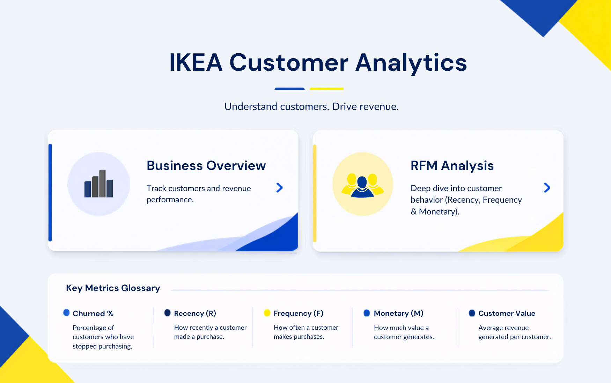

# IKEA Gifting: Customer Analytics and RFM Segmentation


> **Disclaimer.** "IKEA Gifting" is a fictional company made up for this educational portfolio project. It has no connection to the real IKEA. All figures come from a public, anonymised retail dataset, not from any real company. The IKEA colours and logo are used only for dashboard design.

## What this project is
A full analytics workflow for a made up UK online gift and home decor retailer. We start from a business problem, clean 1M+ raw transactions in SQL, segment customers in Python, and present the result in a three page Power BI dashboard.

**The business problem:** leadership has no clear view of which customers matter most or who is drifting away, so retention work is reactive. The aim is to find high value customers and flag the ones at risk of leaving.

## Key results
| Metric | Value |
|---|---|
| Customers analysed | 5,881 |
| Total revenue | $17.4M |
| Champions share of customers / revenue | 22% / 68% |
| Churn (no purchase in 90 days) | 50.86% |
| Average customer value | $2,954 |

- A fifth of customers bring in two thirds of the money.
- Over half the customer base has gone quiet, so retention is a real risk, not a small one.
- Revenue peaks in Q4, which fits a gifting business.

Full findings and what to do for each segment: [docs/FINDINGS_AND_RECOMMENDATIONS.md](docs/FINDINGS_AND_RECOMMENDATIONS.md)

## Dashboard
| Home | Business Overview | RFM Analysis |
|---|---|---|
|  |  |  |

PDF export: [docs/IKEA_Dashboard.pdf](docs/IKEA_Dashboard.pdf)

## Business questions
1. Who are the most valuable customers and how much revenue do they bring?
2. Which customers have gone quiet and may churn?
3. How do value and retention change by month, quarter and year?
4. How do value and churn differ by country?
5. What should the business do for each segment?

## Workflow
1. **Business Requirements Document** ([docs/](docs/BRD_SUMMARY.md)). Scope and definitions were written before touching data.
2. **SQL cleaning** ([01_sql](01_sql)). Fixed mixed date formats, removed 34,335 exact duplicate rows, dropped rows with no customer ID, cancellations and non-positive quantities. Row counts were checked at each step against the published UCI total.
3. **Python segmentation** ([02_python](02_python)). Calculated Recency, Frequency and Monetary per customer, scored each 1 to 5, and assigned one of six segments plus a 90 day churn flag.
4. **Power BI dashboard** ([03_powerbi](03_powerbi)). One flat table feeds all pages. Slicers, a revenue/customer toggle and page navigation.

## Tech stack
SQL Server (SSMS), Python (pandas), Jupyter Notebook, Power BI Desktop, DAX

## Segments
| Segment | Customers | Revenue | Avg value |
|---|---|---|---|
| Champions | 1,291 | $11.84M | $9,169 |
| Loyal | 1,416 | $2.70M | $1,908 |
| At Risk | 821 | $1.59M | $1,932 |
| Lost | 1,524 | $0.65M | $429 |
| New | 442 | $0.39M | $887 |
| Needs Attention | 387 | $0.20M | $529 |

## Repo structure
```
.
├── 01_sql/            cleaning scripts (run in order)
├── 02_python/         cleaning (pandas option), RFM scoring, notebook
├── 03_powerbi/        theme, DAX measures, report notes
├── data/              raw data instructions, customer_segments.csv
├── docs/              BRD, findings, dashboard PDF
└── images/            dashboard screenshots
```

## How to reproduce
1. Download Online Retail II from UCI (link in [data/README.md](data/README.md)) and save the two sheets as CSV in `data/raw/`.
2. Either run the SQL in `01_sql` in order and export `RetailCleaned`, or run `python 02_python/clean_data.py`.
3. Run `python 02_python/rfm_segmentation.py` (needs `pip install -r 02_python/requirements.txt`).
4. Open Power BI, apply `03_powerbi/IKEA_Project_Theme.json`, load `data/processed/retail_segmented.csv`.

## Team
| Name | Role in project | GitHub |
|---|---|---|
| YOUR NAME | e.g. SQL cleaning / Python / Power BI | [@adityatwice123](https://github.com/adityatwice123) |
| TEAMMATE 2 | | |
| TEAMMATE 3 | | |

## Data source and credit
Online Retail II, UCI Machine Learning Repository. Donated by Daqing Chen. Licensed under CC BY 4.0. 1,067,371 transaction rows from a UK online gift retailer, December 2009 to December 2011.

## Contact
Aditya Sharma, [LinkedIn](https://www.linkedin.com/in/adityasharma-97abb6314), adityatwice123@gmail.com
